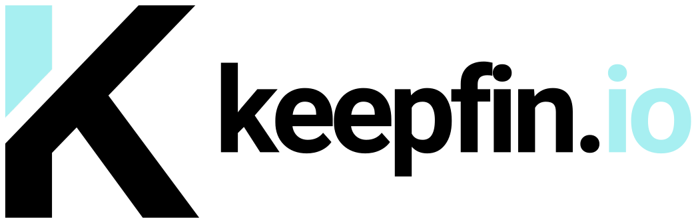

<p align="center">
  <picture>
    <source media="(prefers-color-scheme: dark)" srcset="web/public/brand/keepfin-dark.svg">
    
  </picture>
</p>

<h1 align="center">Your finances, in one place.</h1>

<p align="center">
  An open-source, self-hosted portfolio tracker for understanding your accounts,
  investments, and cash.<br>
  Built with Go, Vue, PostgreSQL, and Better Auth.
</p>

<p align="center">
  <a href="LICENSE">MIT License</a> ·
  <a href="#quick-start">Quick start</a> ·
  <a href="#contributing">Contributing</a> ·
  <a href="https://github.com/keepfin-io/keepfin.io/issues">Issues</a>
</p>

Keepfin brings financial accounts and investment activity into a single view.
Record transactions, follow your holdings, and understand how your portfolio
changes over time while hosting the application and its database yourself.

**Status:** active development. Features and database migrations are evolving;
back up your database before upgrading. The feature list below describes the
currently connected application flows, not the entire roadmap.

## Features

- **Accounts and holdings** — manage financial accounts, opening cash, positions,
  currencies, and account inclusion in portfolio totals.
- **Transaction history** — record purchases, sales, deposits, withdrawals,
  dividends, interest, fees, and transfers between accounts. Balances and
  positions are rebuilt from the transaction ledger.
- **Portfolio analysis** — view portfolio value, cash, invested capital,
  realized and unrealized gains, income, historical performance, allocations,
  and supported benchmark comparisons.
- **Account and asset details** — explore an individual account's performance
  or a holding's prices and related transactions.
- **Asset discovery and search** — find market instruments, reuse recent
  selections, and browse holdings with filters, sorting, and pagination.
- **Multi-currency reporting** — use historical exchange rates to value accounts
  in a reporting currency. Missing data stays visible instead of becoming a
  fabricated balance.
- **CSV import and export** — preview transactions before importing, detect
  duplicate rows, and export account activity.
- **Authentication** — same-origin cookie sessions with Better Auth, local
  development magic links, and optional Google sign-in.
- **Interface** — English and Turkish, light and dark themes, and responsive
  pages for account and transaction workflows.

Market search, quotes, price history, and historical FX currently use **EODHD**.
Availability, delays, and request limits depend on your provider plan.
Typesense powers holdings search; PostgreSQL remains the source of truth and
provides a fallback when the search index is unavailable or behind.

## Quick start

### Requirements

- Git
- Docker with Docker Compose v2
- Make and OpenSSL for the development setup scripts

Docker runs the services on Linux containers; your host can be macOS, Linux,
or Windows with WSL2. A separate Linux machine is not required.

```sh
git clone https://github.com/keepfin-io/keepfin.io.git
cd keepfin.io
make hot
```

Open **[localhost:8080](http://localhost:8080)**. The first start builds the
services, installs frontend dependencies, and applies database migrations.
`make hot` generates local authentication and search secrets in ignored files.

For market data, add your own token to the generated `.env` file, then restart
the development stack:

```dotenv
EODHD_API_TOKEN=your-eodhd-token
```

Without a token, you can explore the application and manage accounts, but market
search and valuations that need provider data will be unavailable. Keep API keys
on the server; never put them in `VUE_APP_*` variables or commit local env files.

### Sign in locally

The development stack enables **Internal testing sign-in** on the login page:

```text
Username: internal-testing
Password: 12345
```

This is a development-only admin account. The auth service rejects this mode in
production. You can also enter an email address and open the sign-in URL from
the corresponding local `.auth-mail/*.json` file. Development email is written
to disk, not sent to a mailbox.

See [authentication setup](auth/README.md) for Google OAuth, account mapping,
session behavior, and deployment configuration.

To stop the stack while keeping its data:

```sh
make down
```

## Configuration and deployment

[`.env.example`](.env.example) documents the production environment variables.
The production Compose file requires database credentials, a random
`BETTER_AUTH_SECRET`, a private `TYPESENSE_API_KEY`, and the exact public HTTPS
`APP_ORIGIN`.

For a fresh deployment, copy `.env.example` to `.env`, fill in the values, and
configure Google OAuth before starting:

```sh
docker compose up --build -d
```

The frontend binds to `127.0.0.1:8080`; place a TLS reverse proxy in front of it.
The database, auth service, Go API, and Typesense stay on the private Compose
network. PostgreSQL and Typesense data use persistent Docker volumes. Runtime and
migration database credentials are separate. Existing installations must follow
the [database security upgrade steps](docs/database-security.md) before restarting.

**Production email delivery is not implemented yet.** Configure Google sign-in
for production use. Apple sign-in is currently a placeholder. Read the
[deployment notes](auth/README.md#deployment) before exposing an instance.

Self-hosting keeps application records in your database. Requests for market
data, asset images, and configured OAuth sign-in still use external services.

## Development

The Compose development stack reloads Go, Vue, and auth changes. For tools run
directly on your host, use **Go 1.27+** and **Node.js 26**; `.nvmrc` selects the
repository's Node version.

```text
app/         Go controllers, models, queries, and services, grouped by domain
auth/        Better Auth service and authentication tests
pkg/         Ledger calculations, middleware, routes, and search integration
platform/    Database setup and migrations
web/         Vue application, translations, and UI tests
scripts/     Local environment setup
docs/        Implementation notes and feature tracking
```

See the [backend guide](app/README.md), [frontend guide](web/README.md), and
[authentication guide](auth/README.md) for component-specific details.

### Checks

Run these from the repository root with the host toolchains installed:

```sh
go test ./...
go vet ./...

npm --prefix auth ci
npm --prefix auth test
npm --prefix auth run build

npm --prefix web ci
npm --prefix web run lint -- --no-fix
npm --prefix web run build
npm --prefix web run test:ui
```

UI tests run against the production build in jsdom with mocked responses;
they do not replace real-browser or live-provider testing. Database and search
integration suites are opt-in: see the [backend guide](app/README.md) for
`PORTFOLIO_TEST_DATABASE_URL`, `AUTH_TEST_DATABASE_URL`, and Typesense settings.

## Roadmap

Work in progress includes watchlists, manual asset valuations, liabilities and
net worth, tags, consolidated activity views, configurable risk checks, FIRE
projections, portfolio sharing, additional performance methods, market-data
jobs, JSON and dividend imports, and PWA/Zen modes.

Follow the [implementation checklist](docs/wealth-implementation.md) for scope
and progress. These items are not all available end to end yet.

## Contributing

Bug reports, documentation improvements, translations, and pull requests are
welcome. For a larger change, open an issue first so the scope can be discussed.

1. Fork the repository and create a focused branch.
2. Keep changes consistent with the existing domain packages and Vue components.
3. Add relevant tests, especially for financial calculations, ownership checks,
   imports, and database changes.
4. Run the checks above and describe what you verified in your pull request.

For bug reports, include reproduction steps and your environment. Remove account
data, credentials, tokens, and other private information from examples and logs.

## Financial information

Keepfin is a financial tracking and analysis tool. It does not provide investment,
financial, tax, or legal advice. Market data and calculations may be delayed,
incomplete, or inaccurate; verify them independently before making decisions.

## License

Keepfin is open-source software released under the [MIT License](LICENSE).
Third-party dependencies retain their respective licenses.
